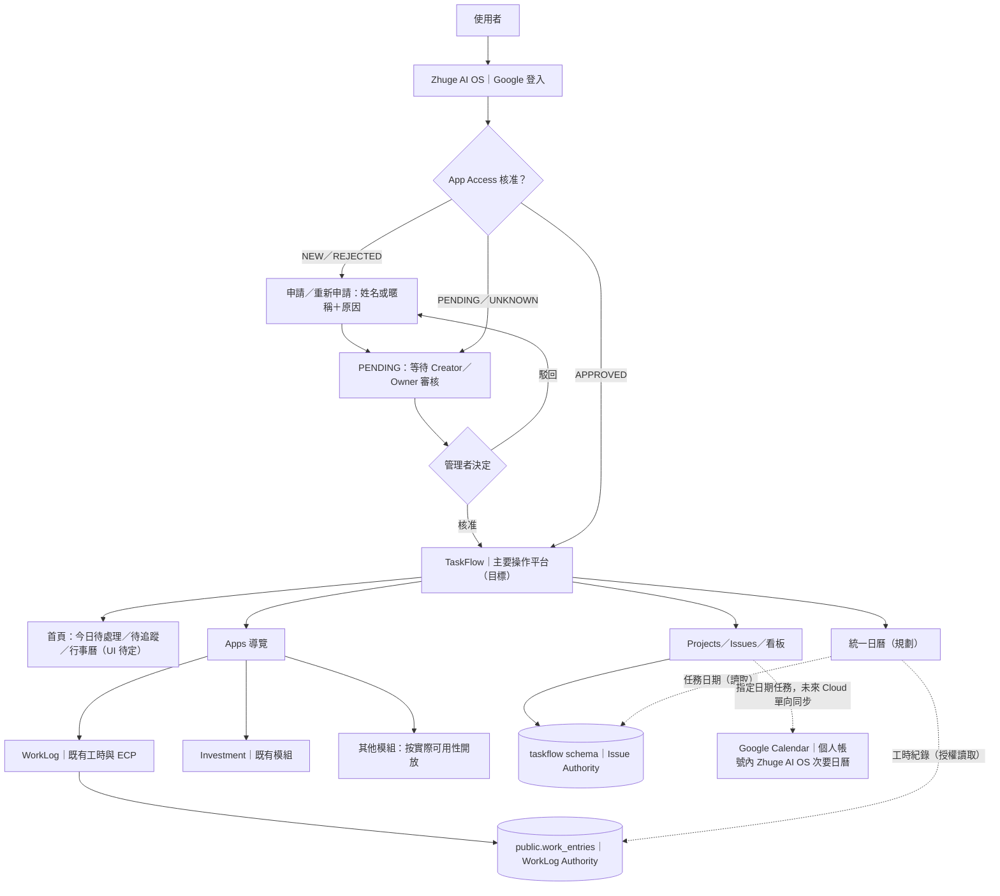
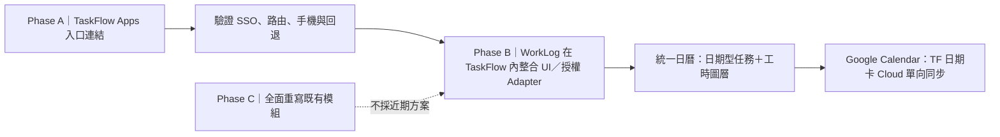
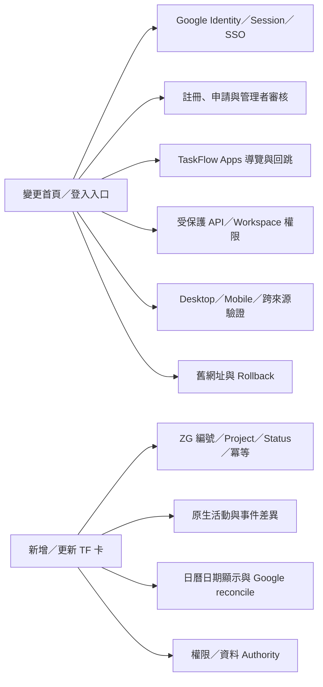

# Zhuge AI OS｜PM × CTO 產品藍圖（候選）
> **讀圖優先；產品決策與實際上線狀態必須分開。**
>
> PM 確認日期：2026-10-13（Asia/Taipei）；文件候選：v0.1；來源：PM／CTO 當日規劃與 GitHub 原始碼盤點。
> 本文件記錄 **PM 已核准的產品目標**，不是現有功能全部已上線的宣告。正式 Source／Cloud Contract 仍決定現在實際會怎麼運作。
> 同步檢視：[使用流程](PM_CTO_USER_FLOWS.md) · [現況](PM_CTO_PROJECT_STATUS.md) · [PM 決策日誌](../10_GOVERNANCE/PM_PRODUCT_DECISIONS.md)。

## 一、產品全景圖（目標架構）

**產品名稱為 Zhuge AI OS；TaskFlow 是主要工作平台與前台容器**。舊 AI OS 的實際功能不消失，而是轉為 Apps 來源。入口統一 **不代表** 必須把所有資料搬進 `taskflow` schema。

### 功能定位

| 區塊 | PM 使用目的 | 目前定位 |
| --- | --- | --- |
| Home | 今天要處理什麼、今日行程、待追蹤、近期到期 | **需求已確認；首頁 UI 未定稿，Coding HOLD** |
| TaskFlow | Project／Issue／看板／工作流程 | 既有原生能力，持續候選修正 |
| Calendar | TF 任務日期、WorkLog 完成工時不同圖層；未來會議時間 | 架構方向已核准，待分階段整合 |
| Apps | WorkLog、Investment 等原模組入口 | Phase A 導覽捷徑；Phase B 功能融合 |
| 管理與存取 | 登入、註冊申請、Creator／Owner 審核及權限 | 既有 AI OS 流程，TF 接入尚待驗證 |
| Usage／Errors | 原生 AI Token、成本、執行分析 | 不作首頁、非優先；不等於需要刪除原生能力 |

## 二、模組整合階段（A → B，不直接 C）

- **A**：WorkLog 等原模組保留現況，TF 側欄提供入口、返回與狀態提示；不可讓未核准者用舊 URL 繞過 App Access。
- **B**：TaskFlow shell 下融合模組 UX，保留 WorkLog 登錄／修改、工時統計、日曆、ECP 匯出與歷史紀錄；不把 WorkLog 改寫成 TaskFlow Issue。
- **C**：全部重寫暫不採用。舊 AI OS 入口在過渡期保留作 rollback；除非 PM 另行核准，不停用舊路由。

## 三、變更影響圖（規劃前的提醒網）

以上是 **最低檢查清單，不代表所有箭頭已實作**。每次 PM 變更登入、首頁、任務、日曆、資料寫入或 Apps，CTO 必須照圖檢查影響，不得只修改單一畫面。

## 四、不可遺失的產品規則

1. Google 驗證成功不等於產品使用權；**未核准的 NEW／PENDING／REJECTED／UNKNOWN 均不得取得 TF、Apps 和受保護資料／API 存取**。不得只做前端遮罩。核准後仍須核對 TF Workspace 權限。
2. 申請資料為 Google Email（唯讀）、姓名／暱稱與申請原因；Creator／Owner 可核准、駁回、查看歷史，駁回後可重新申請。保留管理後台。
3. WorkLog `public.work_entries` 是真實工時；TF `taskflow.issue` 是任務／日期。只能以清楚的授權契約整合檢視，不能任意 JOIN `work_entries.task_uuid` 與 TF Issue UUID。
4. TF 任務 `start_date`／`due_date` 是 date-only。未來 Google 同步為 **有日期的全部 TF Issue** → 個人次要日曆，第一階段單向、背景補漏；WorkLog 完成工時預設不同步。日期不等於預約時間。
5. CTO 經現有 Supabase Connector 朝受控 TF 建卡／更新實作；PM 知道共用 postgres 身分邊界，仍須驗證編號、關聯、最小權限、必要紀錄和直接 SQL 的事件差異；**未核准不寫 Production**。
6. 保護 Frozen Vendor、工作紀錄、現有 Auth／RLS 與已驗證性能；候選開發、正式合併與 Production Release 是不同授權。
7. 首頁突出今日待辦、待追蹤、行事曆、近期到期、WorkLog 摘要。**Token／成本／Agent 執行分析不出現在首頁**；Dashboard 版型待 PM 討論。

## 五、資料與設計權威界線

- **PM 決策**：本藍圖與 PM 決策日誌記錄產品目標及變更歷史。
- **現況事實**：GitHub `main`／TaskFlow 工作分支 Source、正式 Runtime、Supabase Cloud Contract 才是實際行為與資料之證據；本藍圖不取代它們。
- **既有治理**：`EP-039`、Shared-first、Golden Master 等未經 PM 明確修改前照既有適用範圍執行。TaskFlow 新 shell 與舊 Module A／C 的邊界須由正式 ADR 審查後才可取代，不得默默宣告舊原則作廢。
- **Figma 使用時機**：只有 UI 畫面進入設計階段才建立連結的 Figma Wireframe；它是視覺設計稿，不是權限或資料流程的 Authority。
- **每次改動**：先標明 `決策已核准／候選開發中／QA 通過／正式上線`，再更新圖及相關決策日誌；不可把願景當成已交付功能。
