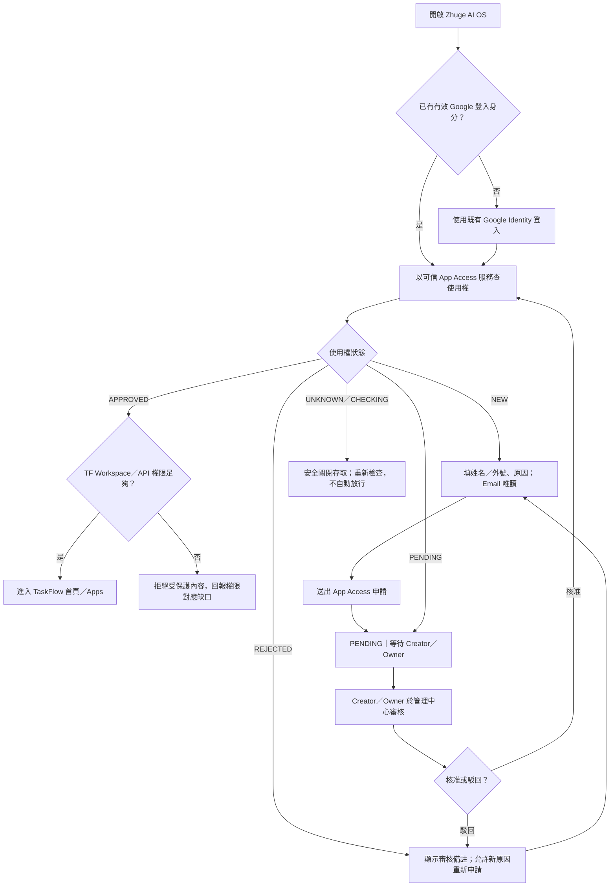
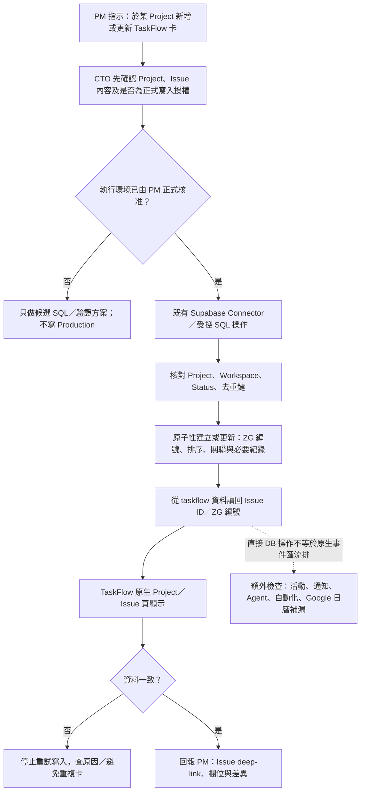
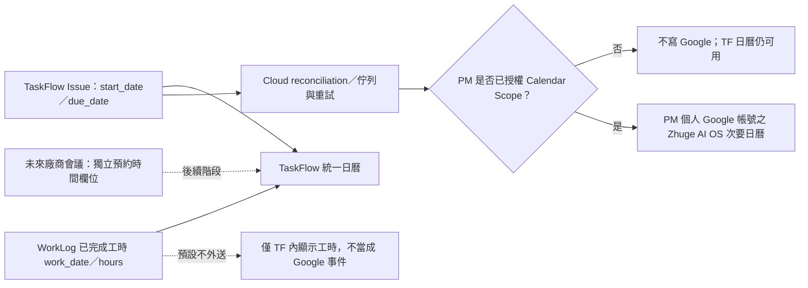

# Zhuge AI OS｜PM × CTO 使用流程圖（候選）
> PM 確認需求日期：2026-10-13。圖中的「目標」流程不得被理解為當前 Production 全數已實現。
> 導覽：[產品藍圖](PM_CTO_PRODUCT_BLUEPRINT.md) · [決策日誌](../10_GOVERNANCE/PM_PRODUCT_DECISIONS.md) · [現況](PM_CTO_PROJECT_STATUS.md)

## 流程 01｜登入、新帳號註冊與 PM 核准

### 不得省略的例外與驗收
- **Google 登入≠核准**；查不到授權、服務錯誤、正在審核、已拒絕，均不能放行。
- 新帳號 Google Email 取自登入身分，表單不得任意替換；申請姓名／外號和原因必填。
- Creator／Owner 保留審核歷史、原因、備註與拒絕後重新申請；不得建立第二套獨立核准權威。
- TF 直接網址、深連結、API、WorkLog 等 Apps 皆須驗證後端使用權及各自資料權限；不能只依首頁 UI gate。
- 核准後仍要確認 TaskFlow Workspace membership／service 身分映射；不得只以 Google email 猜測角色。
- Session 過期後安全重新登入並在權限允許下返回原路徑；舊 AI OS 網址於過渡期可返回。

**現況 Source 參照**：`shared/auth/app-access-service.js`、`shared/auth/app-access-gate.js`、`shared/components/user-access-management.js`；TF 端 SSO/後端存取整合仍需 Candidate QA。

## 流程 02｜PM 要 CTO 建立 TaskFlow 卡片（目標）

### 不可偷換的語意
- PM 支持**現有 Connector 直接寫 SB → TF 顯示**，但不等於核准給共用 `postgres` 全 schema DML 或立刻操作正式卡。
- 最小授權與交易完整性要可驗證；不把任意 caller UUID 偽裝成經認證的 PM 身分。
- SQL 直接寫不觸發所有原生事件；功能缺口必須明列，不可聲稱與原生 Create API 完全等價。
- 關聯 #42；正式首次寫入／Grant／Migration 的 PM Gate 仍有效。

## 流程 03｜統一日曆與 Google Calendar（目標）

### 時間與權限規則
- TF `start_date`、`due_date` 為日期，不自動推定某個小時。只有到期日者建立當日全天事件；只有開始日者建立註明開始的全天事件；都有者以到期日為全天事件、開始日進描述。
- TF 直接 DB 寫入也必須被 Cloud 定期補償掃描捕捉；同張卡只對應一個穩定 Calendar Event，更新用同一 mapping。
- WorkLog `public.work_entries` 與 TF `taskflow.issue` 資料權威獨立。兩者可以顯示在同個日曆，不強行共用任務外鍵。
- OAuth 使用個人帳號單獨授權 Calendar Scope；未連線／撤銷時，不寫入 Google；不要用共用 SQL 角色冒充 Google 使用者。
- 真正有起迄時段的會議與任務期限是不同事件種類；Google → TF 雙向目前不做。
- 關聯 #46、#47。首次操作 PM 正式 Google Calendar 必須另行批准。

## 圖表更新約定
任何涉及登入、授權、建立卡片、模組日期或同步的 PM 變更，CTO 須先在圖上說明**入口、判斷節點、失敗分支、資料權威與 Rollback**，並於 [PM 決策日誌](../10_GOVERNANCE/PM_PRODUCT_DECISIONS.md) 記錄；不能只加一個沒有行為定義的心智圖節點。
